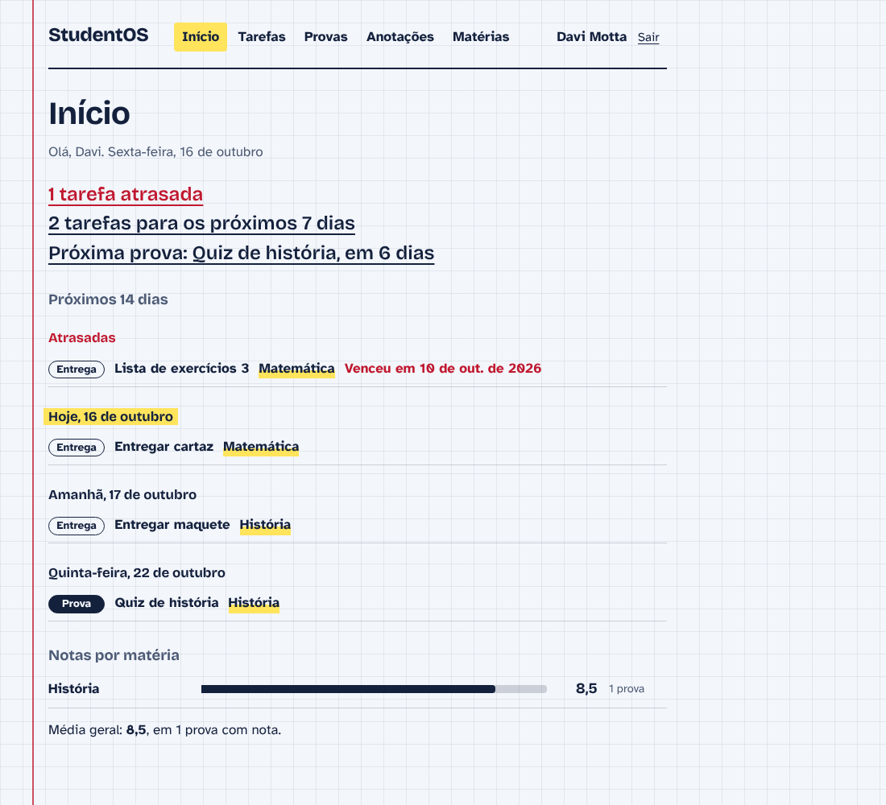
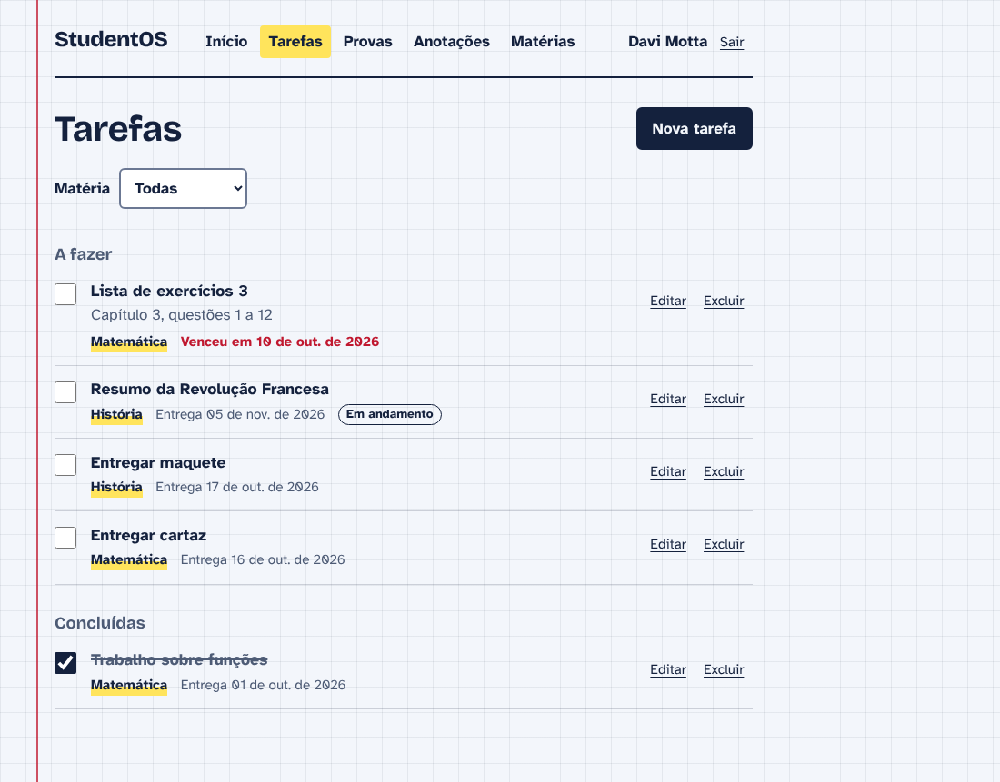
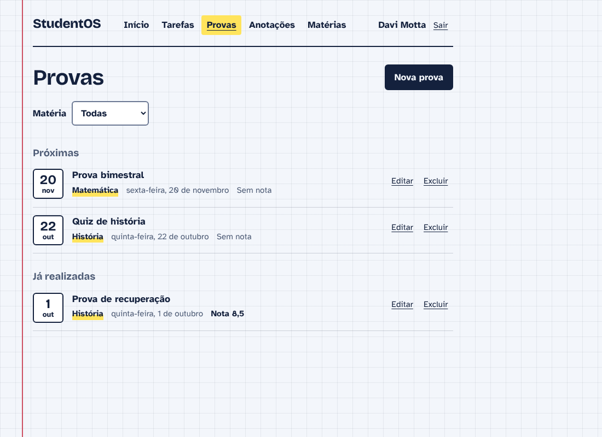
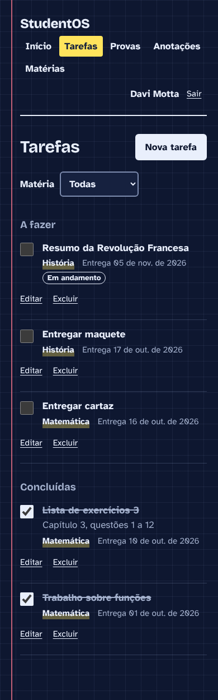

# StudentOS

A web app that helps students organize school life: subjects, tasks, exams, grades and notes, all in one place. Each person has their own account and only sees their own data.

> The interface is in Brazilian Portuguese, since the app was built for Brazilian students.



## Features

- **Accounts:** sign up, log in and log out. Data is fully separated per user.
- **Dashboard:** overdue tasks, what is due this week, the next exam, a 14-day agenda and the grade average per subject.
- **Tasks:** to-do and done lists, overdue highlighting, one-click completion.
- **Exams:** upcoming and past exams with grades.
- **Notes:** written notes grouped by subject.
- **Subjects:** deleting a subject also removes its tasks, exams and notes (with a confirmation).
- Filters by subject, light and dark themes, responsive layout, keyboard friendly.

| Tasks | Exams | Mobile (dark) |
| --- | --- | --- |
|  |  |  |

## Tech stack

- **Back end:** Ruby on Rails 7.2 (API only), SQLite, bcrypt, Minitest
- **Front end:** React 19, Vite, plain CSS, Oxlint
- **Quality:** GitHub Actions running Rubocop, Brakeman, the Rails tests, and front-end lint, tests and build on every pull request

## Decisions worth mentioning

- **Authentication from scratch:** passwords hashed with bcrypt; login returns a random opaque token and only its SHA-256 digest is stored, so a database leak does not expose usable tokens. Tokens expire after 30 days and logout revokes only the current one.
- **Data isolation:** every query starts from the logged-in user, other people's records answer `404`, and tasks, exams and notes cannot be created or moved into someone else's subject. All of this is covered by tests.
- **Error handling in the UI:** validation messages from the API show up in the form, expired sessions send the user back to login with a notice, and the app works without a router library.

## Running locally

You need Ruby 3.3, Node.js 22 and a C compiler (bcrypt builds native code).

```bash
# Back end
cd back-end
bundle install
bin/rails db:setup
bin/rails server        # http://localhost:3000

# Front end (another terminal)
cd front-end
npm install
npm run dev             # http://localhost:5173
```

Open the front end and choose **Criar conta** (create account). Run the tests with `bin/rails test` in `back-end` and `npm test` in `front-end`. More details in [back-end/README.md](back-end/README.md) and [front-end/README.md](front-end/README.md).

## Next steps

- Upgrade to Rails 8
- Rate limiting on login attempts
- Calendar grid view for the agenda

## Author

Davi Motta Peluci, software development intern. [LinkedIn](http://www.linkedin.com/in/davi-motta-peluci-b40b863b6)
